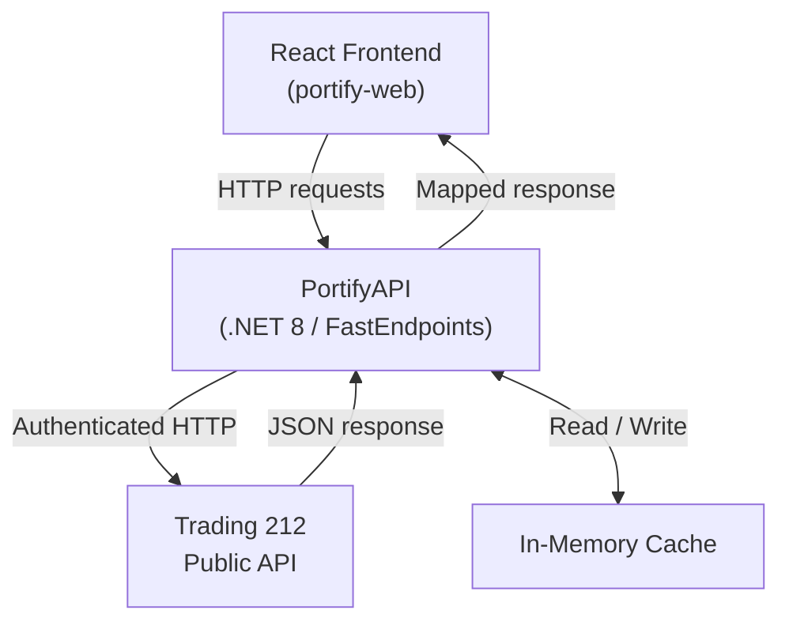
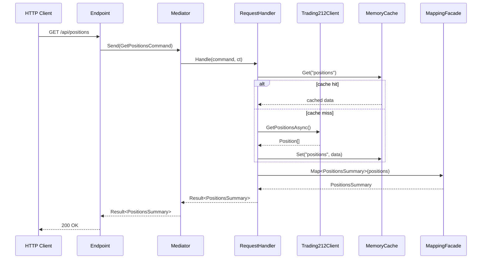
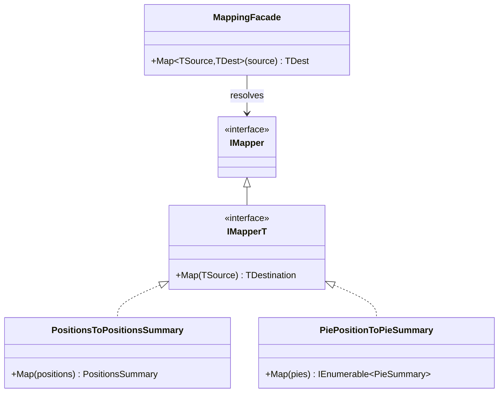
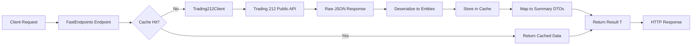

# Portify

A personal portfolio management platform that integrates with the [Trading 212 Public API](https://t212public-api-docs.redoc.ly/) to retrieve, analyze, and visualize investment portfolio data in real time.

> **Note:** This project was built primarily as a **learning exercise** to study the [FastEndpoints](https://fast-endpoints.com/) framework and apply clean architecture, CQRS, and SOLID principles in a real-world .NET context.

---

## Table of Contents

- [Project Overview](#project-overview)
- [Objectives and Learning Goals](#objectives-and-learning-goals)
- [Architecture Overview](#architecture-overview)
- [Features](#features)
- [Technology Stack](#technology-stack)
- [API Workflow](#api-workflow)
- [Project Structure](#project-structure)
- [Installation and Setup](#installation-and-setup)
- [Configuration](#configuration)
- [Running the Project](#running-the-project)
- [Future Improvements](#future-improvements)
- [Lessons Learned](#lessons-learned)
- [Contributing](#contributing)
- [License](#license)

---

## Project Overview

Portify is a full-stack portfolio dashboard that connects to a real Trading 212 account and surfaces live data through an interactive UI. The backend is a .NET 8 API built with FastEndpoints, exposing endpoints for account stats, open positions, and pie allocations. The frontend is a React + TypeScript SPA that consumes those endpoints and renders charts, tables, and filterable views.

---

## Objectives and Learning Goals

| Goal | Implementation |
|------|---------------|
| Understand and implement FastEndpoints | Every HTTP route is a self-contained `Endpoint` class |
| Learn CQRS commands and queries | Each feature folder contains a `Command` and a `Handler` |
| Implement object mapping between layers | Custom `IMapper<TSource, TDestination>` interface with a `MappingFacade` |
| Follow SOLID principles | Single-responsibility endpoints, open/closed mappers, dependency-inverted infrastructure |
| Explore clean architecture patterns | Features are vertically sliced; infrastructure is behind an interface |

---

## Architecture Overview

### High-Level Structure



### CQRS Pipeline

Each feature follows a vertical-slice pattern. An HTTP request arrives at an `Endpoint`, which dispatches a `Command` through a lightweight custom `Mediator`. The `Handler` calls the Trading 212 client, maps the result, and returns a `Result<T>`.



### Mapping Layer

Mappings are implemented as explicit classes that implement `IMapper<TSource, TDestination>`. They are registered with the DI container and resolved at runtime through a `MappingFacade`, keeping transformation logic out of handlers and endpoints.



---

## Features

- **Live portfolio data** — fetches positions, account stats, and pie allocations from a real Trading 212 account
- **Stat cards** — total portfolio value, amount invested, unrealized P&L, and realized P&L
- **Trend chart** — portfolio value over time
- **Currency exposure chart** — doughnut chart breaking down allocation by currency
- **Top positions chart** — horizontal bar chart of positions by current value
- **Unrealized P&L chart** — per-position profit/loss visualization
- **Positions table** — sortable, filterable, paginated table with search
- **Pies grid** — per-pie cards showing allocation, return, and holdings breakdown
- **Refresh button** — manually trigger a re-fetch of all data
- **Responsive UI** — works across different screen sizes

---

## Technology Stack

### Backend

| Technology | Purpose |
|------------|---------|
| .NET 8 | Runtime |
| [FastEndpoints 8](https://fast-endpoints.com/) | HTTP endpoint framework |
| Serilog | Structured logging |
| `IMemoryCache` | In-process caching |
| Docker | Container support |

### Frontend

| Technology | Purpose |
|------------|---------|
| React 19 | UI framework |
| TypeScript | Type safety |
| Tailwind CSS | Utility-first styling |
| Chart.js + react-chartjs-2 | Data visualization |

---

## API Workflow

### Authentication

Trading 212 uses **Basic Authentication**. Credentials (username + password/API key) are Base64-encoded and sent as an `Authorization: Basic <token>` header on every outbound request from `Trading212Client`.

### Data Retrieval Flow



### Endpoints

| Method | Path | Description |
|--------|------|-------------|
| `GET` | `/api/accounts` | Account overview: total value, cash, investments P&L |
| `GET` | `/api/positions` | All open positions with currency and per-stock summaries |
| `GET` | `/api/pies` | All pie allocations with per-pie stock breakdowns |

### Caching

Responses from Trading 212 are cached in-process using `IMemoryCache`. The default expiration is configured in `appsettings.json` under `CacheSettings.DefaultExpirationMinutes` (default: 20 minutes). This is essential to avoid hitting the upstream rate limit.

---

## Project Structure

```
portify/
├── PortifyAPI/
│   └── PortifyAPI/
│       ├── Entities/               # Domain models and DTOs
│       ├── Features/
│       │   ├── Accounts/           # GetAccount command + endpoint
│       │   ├── Pies/               # GetPies, GetPieById commands + endpoints
│       │   ├── Positions/          # GetPositions command + endpoint
│       │   └── Shared/
│       │       ├── Cache/          # ICache abstraction + MemoryCache impl
│       │       ├── Mapper/         # IMapper, MappingFacade, mapping profiles
│       │       ├── Mediator/       # Custom IMediator, IRequest, handler registry
│       │       └── Results/        # Result<T>, error types (NotFound, InternalServerError)
│       ├── Infrastructure/
│       │   └── Trading212/         # HTTP client + options
│       └── Program.cs
└── portify-web/
    └── src/
        ├── components/
        │   ├── dashboard/          # Chart components (Trend, Currency, TopPositions, PnL)
        │   ├── layout/             # Sidebar
        │   ├── pies/               # PieCard, PiesGrid
        │   ├── positions/          # PositionRow, PositionsTable
        │   └── shared/             # Badge, Card, StatCard
        ├── data/
        │   └── mock.ts             # Chart color constants and fallback data
        ├── hooks/
        │   └── useDashboardData.ts # Data fetching hook with sequential API calls
        ├── pages/
        │   └── Dashboard.tsx       # Main dashboard page
        ├── services/
        │   └── api.ts              # Typed fetch wrappers for all endpoints
        └── types/
            └── index.ts            # Shared TypeScript types
```

---

## Installation and Setup

### Prerequisites

- [.NET 8 SDK](https://dotnet.microsoft.com/download/dotnet/8)
- [Node.js 18+](https://nodejs.org/) and npm
- A [Trading 212](https://www.trading212.com/) account with API access enabled

### Clone the repository

```bash
git clone https://github.com/your-username/portify.git
cd portify
```

### Install frontend dependencies

```bash
cd portify-web
npm install
```

---

## Configuration

Copy `appsettings.Local.json` (gitignored) and populate your Trading 212 credentials:

```json
{
  "Trading212ClientOptions": {
    "Url": "https://live.trading212.com/api/v0/",
    "Username": "your-trading212-username",
    "Password": "your-trading212-api-key"
  },
  "CacheSettings": {
    "DefaultExpirationMinutes": 20
  }
}
```

> The API will read `appsettings.Local.json` when `ASPNETCORE_ENVIRONMENT` is set to `Local` (the default launch profile).

---

## Running the Project

### Option 1 — VS Code (recommended)

Open the workspace in VS Code and use the **Launch Full Stack** compound configuration from the Run and Debug panel. This starts both the API and the React dev server simultaneously.

### Option 2 — Terminal

**API:**
```bash
cd PortifyAPI/PortifyAPI
dotnet run
# Listens on http://localhost:5174
```

**Frontend:**
```bash
cd portify-web
npm start
# Opens http://localhost:3000
# Proxies /api/* to http://localhost:5174
```

---

## Future Improvements

- [ ] Add historical portfolio value endpoint to power the trend chart with real data
- [ ] Add authentication to the Portify API (JWT or API key)
- [ ] Persist portfolio snapshots to a database for trend tracking
- [ ] Add dividend tracking and income projections
- [ ] Support for multiple brokerage integrations beyond Trading 212
- [ ] Unit and integration tests for handlers and mapping profiles
- [ ] Dark/light theme toggle
- [ ] Mobile-optimised layout

---

## Lessons Learned

- **FastEndpoints** provides a much leaner alternative to controllers for feature-sliced APIs; co-locating the endpoint, command, and handler in a single folder makes the feature boundary immediately obvious.
- **Custom Mediator** — implementing a minimal mediator from scratch (rather than pulling in MediatR) made the dispatch mechanism transparent and reinforced understanding of the pattern.
- **Rate limiting awareness** — firing parallel requests to an upstream API that enforces rate limits requires sequential orchestration on the client side, not just caching on the server side.
- **Mapping without AutoMapper** — hand-written mapping profiles are more verbose but provide compile-time safety and make transformations easy to trace and test.

---

## Contributing

This is a personal learning project, but feedback and suggestions are welcome. Feel free to open an issue or submit a pull request.

---

## License

This project is licensed under the [MIT License](LICENSE).
